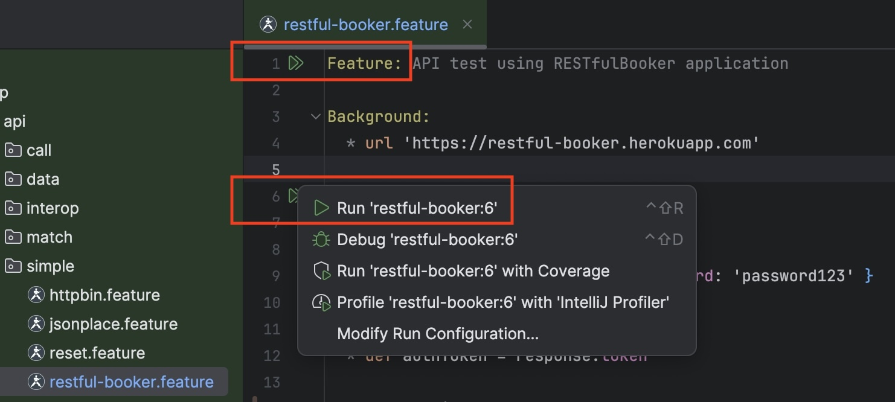

# Karate IntelliJ Plugin

## API, Performance, and UI testing — natively in IntelliJ IDEA

Write, run, and debug Karate tests with built-in test runner integration, breakpoint debugging, and OpenAPI / Swagger import.

---

  

---

### [:globe_with_meridians: **Visit the Documentation Site**](https://docs.karatelabs.io/ide-support/intellij/)

**Everything you need is here:**
Installation • Quick Start • Features • License Activation

---

[:zap: JetBrains Marketplace](https://plugins.jetbrains.com/plugin/19232-karate) •
[:heavy_dollar_sign: Pricing](https://www.karatelabs.io/pricing) •
[:octocat: Report Issues](https://github.com/karatelabs/intellij-plugin/issues)

